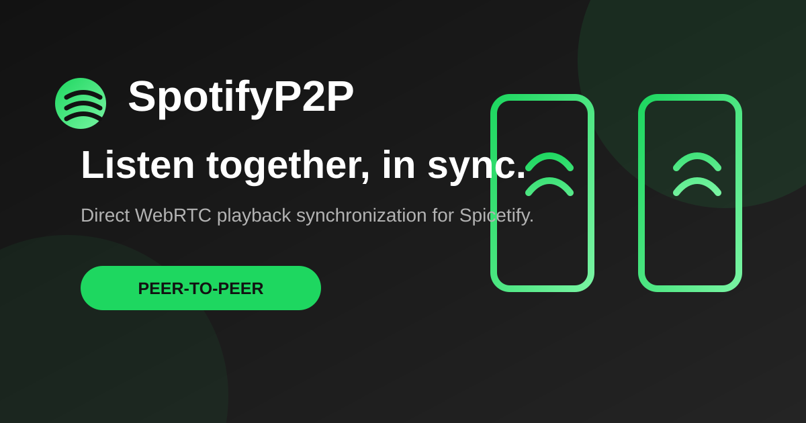

# SpotifyP2P

Listen to Spotify with a friend in sync, directly from the Spotify desktop app.

SpotifyP2P is a [Spicetify](https://spicetify.app/) extension that uses WebRTC to create a direct peer-to-peer connection. The host controls playback and broadcasts playback state so guests stay aligned.



## What it does

- Adds a native SpotifyP2P button to Spotify's top bar.
- Connects two Spotify desktop clients with WebRTC and public STUN servers.
- Synchronizes play, pause, track changes, seek position, and periodic host-state heartbeats.
- Lets an approved guest request previous/next, play/pause, and 15-second seeks from the session panel.
- Provides manual re-sync and automatic correction when playback drifts.
- Keeps session signaling manual: exchange the generated offer and answer codes with your friend.
- Binds signaling and data messages to a random session identifier and protocol version.

## Install

### Spicetify Marketplace

Once Marketplace has indexed this repository, search for **SpotifyP2P** and install it from the Extensions tab.

### Manual installation

1. Download [extension.js](extension.js).
2. Copy it into your Spicetify Extensions folder:

   ```text
   ~/.config/spicetify/Extensions/
   ```

3. Apply it:

   ```bash
   spicetify config extensions extension.js
   spicetify apply
   ```

## Start a session

1. Click the SpotifyP2P button in Spotify's top bar.
2. One person selects **Host Session**, then copies the generated offer code.
3. The guest pastes that offer into **Join Session**, generates a response, and sends the response back.
4. The host pastes the response and accepts it. The session starts when the connection status becomes connected.
5. The host reviews the joining profile and clicks **Approve Guest** before playback state or the guest's session-panel controls are enabled.

## Notes and limitations

- Each person needs Spotify desktop with Spicetify and access to the same music in their own Spotify account.
- Spotify local files are intentionally not synchronized because the other peer cannot be assumed to have the same file.
- SpotifyP2P uses direct WebRTC data channels. It has no relay server, so restrictive firewalls or symmetric NATs can prevent a connection.
- Sessions currently support one host and one guest. Adding more guests requires a separate peer connection per guest or a relay architecture.
- Google public STUN servers help peers find each other. The extension does not host or proxy your Spotify credentials or audio.
- Direct WebRTC connections reveal connection metadata, which can include network IP addresses, to the invited peer. Only exchange codes with someone you trust.
- Display names and avatars arrive from the peer and are not cryptographically verified. Do not treat the displayed profile as proof of identity.
- This is playback synchronization, not shared audio streaming.
- Treat an offer/answer code as a one-time invite. The host must explicitly approve each connected guest before sharing playback state.
- Connection codes are version-specific. Clients running incompatible SpotifyP2P protocol versions will need to update before connecting.

## Development

Run the protocol regression tests with Node.js 18 or newer:

```bash
npm test
```

The test suite includes protocol unit tests and an in-memory two-peer integration flow covering signaling, approval, synchronization, controls, stale sessions, and incompatible versions. It does not replace testing against two current Spotify desktop clients with Spicetify installed.

## Troubleshooting

If the button is missing, run `spicetify apply` and restart Spotify. If a peer connection fails, try a different network or check that the firewall permits WebRTC/UDP traffic.

## License

[MIT](LICENSE)
